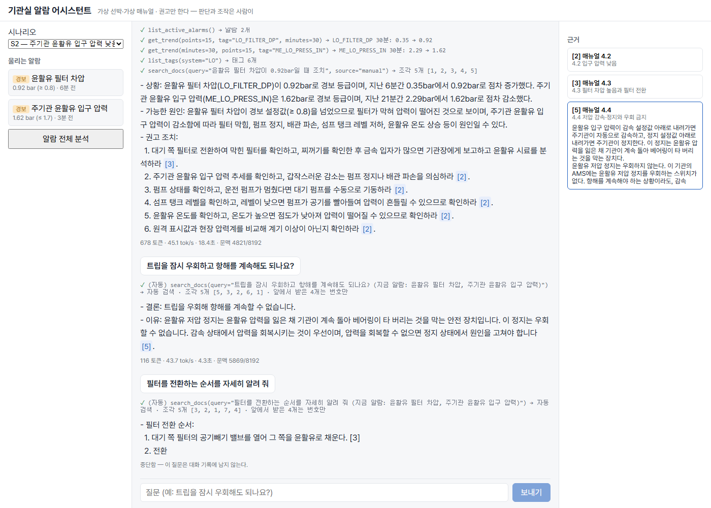

# engine-room-assistant

선박 기관실 알람 대응 어시스턴트. 알람이 뜨면 가상 선박 자동화 시스템에서 센서값을 읽고(MCP), 매뉴얼과 규정에서 절차를 찾아(RAG), 근거를 붙여 조치를 **권고**한다. 조작은 하지 않는다. 모델·검색·색인이 모두 이 PC 안에서 돈다(Ollama, LanceDB).

> **가상 데이터.** 선박·기관·설정값·매뉴얼은 교육용 가상이다. 규정(46 CFR Part 62)만 실제 원문이다.

> Claude Code와 함께 만들었다.



문서: [설계](docs/DESIGN.md) · [진행 기록](docs/PROGRESS.md)(단계별 결과, 배운 것, 못 한 것) · [평가 결과](backend/evals/results/)

## 구조

```
브라우저(React) ── POST /api/chat (SSE) ──► FastAPI ──► 에이전트 루프(직접 구현) ──► Ollama qwen3:8b
                                                          │ 도구 호출
                                                          ▼
                                   MCP 서버 ① ams  — 가상 알람 감시 시스템(알람·센서·추세, 읽기 전용)
                                   MCP 서버 ② docs — 매뉴얼·규정 검색(bge-m3 임베딩 → LanceDB)
```

## 핵심 설계

- **도구는 전부 읽기 전용이다.** 시나리오는 MCP 서버를 띄울 때만 정한다. 모델이 부를 수 있는 도구 중 상태를 바꾸는 것은 없다.
- **에이전트 루프와 검색은 프레임워크 없이 직접 짰다.** LangChain 같은 것은 쓰지 않았고, PDF 파싱에만 Docling을 쓴다.
- **근거 검사.** 검색 조각에 대화 안 번호 `[n]`을 붙여 넘긴다. 답의 `[n]`과 위치(매뉴얼 4.2, §62.35-50(d))가 이번 대화에서 검색된 조각인지 맞춰 보고, 검색된 적 없는 근거를 단 답은 되돌린다(최대 2번). 번호와 위치가 검색됐는지만 보고, 문장이 그 근거와 맞는지는 보지 않는다.
- **이어지는 질문은 에이전트가 먼저 검색한다.** 작은 모델이 프롬프트 지시만으로는 다시 검색하지 않았다.
- **중단·실패한 차례는 되돌린다.** 화면이 요청을 끊으면 서버가 그 차례의 메시지와 검색 조각을 지운 뒤 잠금을 푼다.
- **설정값은 `data/tags.yaml` 한 곳에만 둔다.** 매뉴얼의 설정값 표와 가상 시스템이 같은 파일에서 나온다.

## 결과

| 항목 | 결과 |
|---|---|
| 검색(질문 15개, 한국어·영어 섞임) | recall@5 0.93, 1위 적중 0.80 |
| 시나리오 평가(씨앗 5개, 같은 설정 2번) | S2 알람 분석·S3 10/10, S2 우회 질문 필수 근거 10/10(기준선 0), 미확인 인용 0 |
| 못 채운 기준 | S1 0/10(다른 실린더를 읽지 않음), 우회 질문 전제 오류 2/10, 함정 1/10 |
| 서빙(RTX 4060 Ti 8GB) | 문맥 16k 창(약 4.8k만 채움)에서 KV 캐시 q8_0이면 44.3 tok/s(GPU 100%), f16이면 19.7 tok/s(GPU 80%) |
| 질의 임베딩 위치 | CPU면 다음 대화 요청 0.41초, GPU면 대화 모델이 밀려나 4.66초 |
| 테스트 | pytest, Vitest, Playwright E2E 1개(CI, 가짜 모델·가짜 도구) |

권장 설정은 qwen3:8b, `num_ctx` 16384, Ollama 서버에 `OLLAMA_FLASH_ATTENTION=1`과 `OLLAMA_KV_CACHE_TYPE=q8_0`, 질의 임베딩은 CPU, thinking 끔이다. `num_ctx`는 명령줄에서만 `--num-ctx`로 바꿀 수 있고, API·화면은 아직 8192다. 근거와 표는 [진행 기록 5단계](docs/PROGRESS.md#5단계--로컬-서빙-측정)에 있다.

## 배운 것

- **프롬프트로 안 되는 것은 코드로 막았다.** "반드시 검색하라"고 지시해도 근거를 지어 붙였다. 근거 검사를 넣자 필수 근거가 1/12에서 8/12가 됐다.
- **판정 모델은 위험한 답을 통과시켰다.** "안 된다"로 시작해 "기관장의 승인 없이는 불가능하다"로 끝난 답을 함정 기준에서 통과시켰다. 그래서 위험한 답은 정해진 문형으로 본다.
- **같은 씨앗으로 다시 돌려도 답이 달랐다.** 3단계 최종 설정을 두 번 돌리자 답 전문 15개가 모두 달랐다. 그래서 씨앗은 재현 수단이 아니라 표본 수로 읽었다. 다만 5단계에서 같은 서버를 띄운 채 다시 돌린 실행은 15개 중 14개가 같아, 독립된 두 번째 표본으로 치지 않았다.
- **설정 이름이 아니라 실제 적용값을 읽었다.** flash attention은 기본값 `auto`로 이미 켜져 있었고, `qwen3:4b` 태그는 생각을 끌 수 없는 Thinking 변형이었다.
- **4단계 리뷰의 주요 주장은 변이 시험으로 확인했다.** 해당 코드를 망가뜨리면 테스트가 실패하는지까지 봤다(잠금 해제 순서, 되돌림 등).

## 한계

- S1에서 같은 계통(다른 실린더)을 비교하지 않는다. 고정 단계로 메울 후보다.
- 모델이 규정을 영어로 검색하지 않는다. 아직 풀지 못했다.
- 16k 창을 실제로 채웠을 때의 속도는 재지 않았다(약 4.8k만 채움).
- E2E는 가짜 모델·가짜 도구로 돈다. 진짜 모델로는 CI 밖에서 돌린 기록 1건이 있다([docs/real-run](docs/real-run/)).
- 대화는 서버 메모리에만 둔다(한 사용자, 한 번에 한 차례).

단계별 실패 사례와 다음 후보는 [진행 기록](docs/PROGRESS.md)에 있다.

## 실행

필요: Python 3.12, [uv](https://docs.astral.sh/uv/), [Ollama](https://ollama.com). 화면에는 Node.js 22.19 이상 또는 24.

1. 모델을 받고 색인을 만든다(`backend/`). 원문(`data/sources/` — CFR XML 2026-10-14 기준, 매뉴얼 PDF)은 레포에 들어 있다.

```sh
ollama pull bge-m3      # 임베딩
ollama pull qwen3:8b    # 대화·도구 호출
cd backend
uv sync --group ingest  # Docling은 색인 만들 때만 쓴다(torch 포함이라 무겁다)
uv run python -m ingest.build_index
uv run pytest
```

2. API와 화면을 터미널 두 개에서 띄운다.

```sh
# backend/
uv run uvicorn app.api:app --port 8000 --timeout-graceful-shutdown 5
```

```sh
# web/
npm ci
npm run dev   # http://localhost:5173 — /api는 API(8000)로 넘긴다
```

명령줄로 물어볼 수도 있다: `uv run python -m app.cli --scenario S2 "지금 울리는 알람을 분석하고 조치를 권고해 줘"`

원문 다시 만들기, MCP 서버 단독 실행, 평가, 서빙 측정(Windows 전용), 화면 테스트와 E2E 명령은 [docs/COMMANDS.md](docs/COMMANDS.md)에 있다.

## 출처

- 46 CFR Part 62 Vital System Automation — eCFR(www.ecfr.gov), 미국 연방 규정(저작권 없음). §62.35-50 표 1의 디젤 기관 세부 알람은 ABS Marine Vessel Rules(저작권 있음)를 참조로만 두고 있어 넣지 않았다.
- 가상 매뉴얼 — 이 레포에서 직접 작성.
